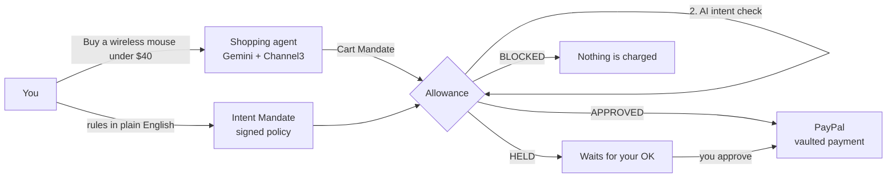

<!-- Path: README.md -->

# Allowance

**Give your AI agent an allowance, not your wallet.**

Allowance is a permission layer that sits between an AI shopping agent and PayPal. You write your rules in plain English, Allowance turns them into a signed spending policy, and every purchase the agent tries to make is checked against that policy (and against what you actually asked for) **before PayPal is ever called**.

Built solo for the **PayPal AI Hackathon 2026**. The design follows the mandate model of Google's **Agent Payments Protocol (AP2)**: an *Intent Mandate* (what the agent may do) and a *Cart Mandate* (what it wants to buy right now).

| | |
|---|---|
| **Live demo** | https://allowance-web-auua.onrender.com |
| **API** | https://allowance-api-5fje.onrender.com |
| **Video** | https://youtu.be/JyJ_PZZXVrw?si=ffTYqgLgYAuDVHFG |

> The demo runs on the **PayPal sandbox**. No real money moves. The API is on Render's free tier, so the very first request after a quiet period can take up to ~50 seconds while it wakes up.

---

## The problem

Agentic commerce is arriving fast, and today there are only two options for letting an agent pay:

1. **Hand it your payment method.** The agent can spend anything, anywhere, and a single prompt injection on a product page can redirect it.
2. **Approve every purchase yourself.** Safe, but then the agent is not really doing anything for you.

People need the middle ground they already use with other humans: *"You can spend up to $200 a month on office supplies. Ask me before anything over $50. Never buy gift cards."* That is an allowance.

## How it works



1. **Set the rules once.** You type something like *"Office supplies and computer accessories only, max $200 a month, ask me above $50."* Gemini drafts a structured policy, it is validated against a strict schema, you review it, and it is signed (HMAC-SHA256). Any later change to the stored policy breaks the signature and stops all spending.
2. **Link PayPal once.** You approve PayPal **once** to save your PayPal as a vaulted payment method (Vault v3). After that, an order can be paid without you clicking through checkout. That ability is exactly why a permission layer is needed.
3. **The agent shops.** It turns your request into a search, finds real products through **Channel3** (live catalog across many stores), picks one, and submits a cart.
4. **Allowance decides.** Every cart goes through two independent gates:
   - **Hard rules (deterministic code, money in integer cents):** mandate active, not expired, signature valid → cart total matches its items → categories allowed and not blocked → merchant allowed → budget for this period not exceeded.
   - **Intent check (AI):** Gemini compares the cart with what you originally asked for. The cart is treated as untrusted data, fenced off in the prompt, and descriptions are trimmed. Below a 0.7 match score, the cart is blocked.
5. **Outcome.**
   - **APPROVED:** within policy and at or below the auto-approve limit. PayPal is charged straight away.
   - **HELD:** within policy but above the auto-approve limit. It waits in *Approvals*. When you approve, the rules and budget are checked again against today's state before PayPal is charged.
   - **BLOCKED:** PayPal is never called. The reason is recorded.

Every step is written to an append-only audit log, visible on the *Activity* page and exportable as CSV.

## Demo scenarios

All three run live against real services: Gemini, Channel3, PayPal sandbox.

| # | You ask | What happens | Result |
|---|---|---|---|
| 1 | "Buy a wireless mouse under $40" | Agent finds a ~$10 mouse | **APPROVED**, paid with PayPal, no click |
| 2 | "Buy an ergonomic office chair under $150" | Agent finds a ~$140 chair, above the $50 limit | **HELD**, you approve, then paid |
| 3 | "Buy a mechanical keyboard under $50" + *Simulate a hijacked agent* | A poisoned product page swaps the pick for a **$45 digital gift card** that *claims* to be in `computer_accessories` | **BLOCKED** |

Scenario 3 is the important one. The attacker lied about the category, so **the hard rules pass**. The AI intent check is what catches it: *the user asked for a physical keyboard, the cart contains a gift card.* You can view the poisoned page itself at [`/demo/poisoned-page`](https://allowance-api-5fje.onrender.com/demo/poisoned-page).

Use **Reset the demo** (bottom left of the app) to clear purchases and restore the full monthly budget.

## PayPal integration

- **Orders v2 + Vault v3.** A setup token is created and approved once by the buyer, then exchanged for a reusable payment token. Each approved cart creates an order with `payment_source.paypal.vault_id`, which completes without a buyer redirect. There is a capture fallback if the order does not complete on create.
- **Idempotency.** `PayPal-Request-Id` is the cart ID, so retrying a payment can never charge twice.
- **No double spending.** A `PENDING` payment row is written *before* PayPal is called, and budget checks count both pending and completed payments. Approving a held cart is a compare-and-set, so two quick clicks cannot pay twice.
- **Fail closed.** If Gemini is unavailable, the intent check is marked as missing and the cart is **blocked**, never waved through.

`api/spike/vault-spike.js` is the small script used to prove the vault flow in the sandbox and to create the demo user's payment token.

## Tech stack

| Layer | Tools |
|---|---|
| Frontend | React 19, Vite 8, Tailwind CSS 4, React Router 7, AG Grid Community (Activity tables) |
| Backend | Node.js 22, Express 5, Zod 4, Prisma 6 |
| Database | TiDB Cloud (MySQL compatible) |
| AI | Google Gemini via `@google/genai` (`gemini-flash-lite-latest`, falling back to `gemini-flash-latest`) with retries and timeouts |
| Payments | PayPal REST APIs (sandbox): Orders v2, Vault v3 payment tokens |
| Product search | Channel3 API |
| Hosting | Render (Web Service for the API, Static Site for the web app) |
| Tests | `node:test`, 98 tests |

## Repository layout

```
allowance/
├── api/                      Express API
│   ├── prisma/schema.prisma  User, IntentMandate, CartMandate, Decision, Payment, AuditLog
│   ├── spike/                PayPal Vault proof of concept
│   ├── src/
│   │   ├── agent/            Shopping agent (plan, search, choose, request payment)
│   │   ├── demo/             Poisoned listing + page for scenario 3
│   │   ├── lib/              Gemini client, HMAC signing, PayPal/Channel3/Prisma setup
│   │   ├── middleware/       CORS allowlist, rate limits, error handler
│   │   ├── routes/           HTTP endpoints
│   │   ├── schemas/          Zod schemas for policies and carts
│   │   └── services/         Policy engine, intent verifier, mandates, carts, PayPal
│   └── tests/                Unit and integration tests
└── web/                      React app (Agent, Approvals, Activity, Rules)
```

## Run it locally

Requirements: Node.js 22+, a MySQL-compatible database (TiDB Cloud's free tier works), a PayPal sandbox app with **Save payment methods** enabled, a Gemini API key, and a Channel3 API key.

```bash
git clone https://github.com/salman-ctrl/allowance.git
cd allowance

# API
cd api
npm install
cp .env.example .env          # fill in the values, see below
npx prisma db push            # create the tables
node spike/vault-spike.js     # one time: approve PayPal in the sandbox, copy the payment token into .env
npm run dev                   # http://localhost:4000

# Web (second terminal)
cd web
npm install
cp .env.example .env          # VITE_API_URL=http://localhost:4000
npm run dev                   # http://localhost:5173
```

Run the tests with `npm test` inside `api/`.

### API environment variables

| Variable | Purpose |
|---|---|
| `DATABASE_URL` | MySQL connection string |
| `MANDATE_SIGNING_SECRET` | At least 32 characters, used to sign mandates |
| `GEMINI_API_KEY` | Google AI Studio key |
| `PAYPAL_CLIENT_ID`, `PAYPAL_CLIENT_SECRET` | PayPal sandbox app credentials |
| `PAYMENT_TOKEN_ID`, `PAYPAL_CUSTOMER_ID` | Vaulted payment method from the spike script |
| `CHANNEL3_API_KEY` | Enables the shopping agent |
| `CORS_ORIGINS` | Comma separated list of allowed web origins |

## API

| Method | Path | What it does |
|---|---|---|
| `POST` | `/mandates/draft` | Plain English → proposed policy (Gemini) |
| `POST` | `/mandates` | Sign and activate a policy |
| `GET` | `/mandates/active` | Current mandate and whether its signature is valid |
| `POST` | `/agent/run` | Run the shopping agent end to end |
| `POST` | `/carts` | Submit a cart directly (for any external agent) |
| `GET` | `/carts` | List carts and decisions |
| `POST` | `/carts/:id/approve` | Approve a held cart and pay |
| `POST` | `/carts/:id/reject` | Reject a held cart |
| `GET` | `/summary` | Budget, active mandate, counts |
| `GET` | `/audit` | Audit log |
| `POST` | `/demo/reset` | Reset demo data |

`POST /carts` means Allowance is not tied to our own agent. Any agent can submit a Cart Mandate and receive a decision.

## Honest simplifications

This is a hackathon prototype, and these are the shortcuts it takes:

- **One demo user.** There is no sign-in. Everyone using the live demo shares one account, which is why the reset button exists.
- **Mandates are signed with a server-side HMAC key**, not with a key the user holds. Full AP2 uses verifiable credentials signed by the user's device. The data model is ready for that, but the signing is simplified.
- **Products are real, the checkout is not with that store.** Channel3 returns live products from real stores. The PayPal payment goes to our sandbox merchant account rather than to the store itself.
- **The vaulted payment token was created once** with the spike script, not through an in-app onboarding flow.
- **Rate limiting is in memory**, which is fine for a single instance only.

## Built with AI

- **At runtime:** Google Gemini drafts policies from plain English, plans and chooses products for the agent, and verifies that each cart matches the user's intent.
- **During development:** Claude was used as a pair programmer for design discussions, code and tests.

## License

MIT, see [LICENSE](LICENSE).
